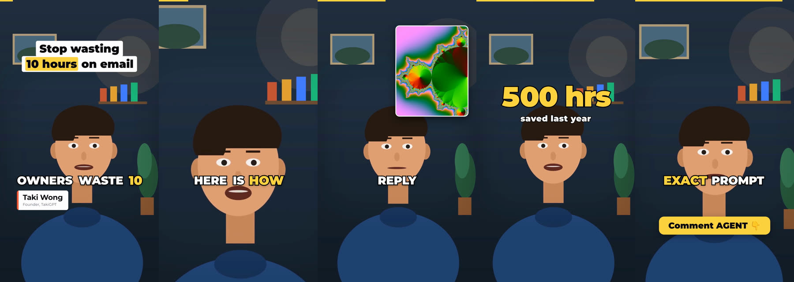
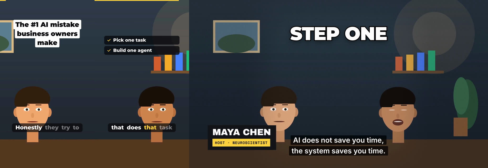

# Agentic Cut

**A lightweight AI video editor for Claude, built on [HyperFrames](https://github.com/heygen-com/hyperframes).**
Drop in a talking-head clip and say what you want. Claude cuts the pauses, filler words and retakes, adds captions,
zooms, text, b-roll, sound and your brand, shows you a preview, and renders a finished short or YouTube video on your
own computer.

Built for the Agentic AI Academy by TakiGPT.





<sub>Frames from real renders. The presenter is a cartoon stand-in used for testing.</sub>

## What it does
- **Cuts the take for you.** Long pauses, "um"s, stutters and retakes come out (it keeps your last take). Voice
  cleaned and levelled.
- **Shorts, long-form and clips.** Vertical shorts for Reels, TikTok and YouTube Shorts; 16:9 YouTube videos; square
  and 4:5 feed posts; and the best moments of a podcast or webinar as vertical clips, the crop following whoever talks.
- **A real toolbox.** 9 caption styles, 6 cut moves, smooth/snap/push zooms, shake and flash, 9 text styles with 8
  animations (hooks, titles, counters, checklists, quote cards, CTAs), b-roll in 4 layouts with 8 transitions,
  10 synthesized sound effects, music that ducks under your voice, HyperFrames' 18 colour looks and 18 film, glitch and
  print treatments, and the whole HyperFrames registry: 450+ lower thirds, overlays, title cards and more, installed on
  demand.
- **Your brand on every frame.** Accent colour, fonts, caption style, look, handle and logo, set once.
- **Preview before render.** A contact sheet of the moments that matter; nothing renders until you say go.
- **Delivers ready to post.** An MP4 at -14 LUFS next to your original clip, plus an SRT caption file.
- **Private and free to run.** Transcription and rendering happen on your computer. No uploads, no per-video fees.

## Install (2 minutes, then a one-time setup)
In Claude Code (terminal, desktop app or IDE):
```
/plugin marketplace add takiw3/ai-video-editor-employee
/plugin install agentic-cut@agentic-cut
/agentic-cut:setup
```
Setup checks for Node.js 22+ and ffmpeg (and gives you the one command to install them if missing), then downloads
the render browser and the on-device speech model. First run: 5 to 10 minutes. It ends with `READY`.

In Claude Cowork: add the GitHub repo `takiw3/ai-video-editor-employee` from your plugin settings, then ask Claude to "set up
Agentic Cut".

## Use it
```
/agentic-cut:edit ~/Desktop/take.mov make it a short with bold captions and a CTA to comment AGENT
/agentic-cut:clips ~/Downloads/podcast-ep12.mp4 five clips under 45 seconds
/agentic-cut:effects lower third
/agentic-cut:brand accent #FF5A36, font Poppins, highlight captions
```
Or just talk: "edit this into a YouTube video", "add a zoom on 'never'", "put the dashboard screenshot in when I
mention it", "make the captions bigger and render again".

| command | what it does |
|---|---|
| `/agentic-cut:setup` | install or check everything (once per computer, and after updates) |
| `/agentic-cut:edit <clip>` | edit a clip into a short, reel or YouTube video |
| `/agentic-cut:clips <long video>` | find the best moments and cut them into shorts |
| `/agentic-cut:effects [words]` | browse effects, looks, caption styles, sounds and registry blocks |
| `/agentic-cut:brand` | set your colours, fonts, caption style, look, handle and logo |

## How it works
```
clip -> transcribe (on device) -> find pauses, fillers, retakes -> one-pass ffmpeg cut + reframe + voice cleanup
     -> plan.json (Claude writes it) -> HyperFrames composition -> preview stills -> render -> loudness -> delivery
```
Each video is a folder in `~/agentic-cut/<name>/` with one file that describes it, `plan.json`
(every field: [skills/agentic-cut/reference/PLAN.md](skills/agentic-cut/reference/PLAN.md)). Claude writes it; you
never have to. The folder is also a normal HyperFrames project, so you can open it in the HyperFrames Studio
(`ac studio`) and keep going by hand.

The engine is about 1,600 lines of plain Node.js, CSS and browser JavaScript, with no dependencies of its own. HyperFrames (pinned to 0.9.42) runs
through `npx`, so there is nothing to build and nothing heavy in this repo.

## Requirements
- macOS, Windows or Linux
- Node.js 22 or newer, and ffmpeg (setup tells you how to get them)
- About 1 GB of free disk for the render browser and the speech model
- Claude Code or Claude Cowork

Rendering runs every frame through a headless browser, so it is not instant: a 30-second short takes a few minutes on
a laptop, long-form proportionally longer. A fast `--draft` render is there for checks.

## Command line
Claude drives it, but you can too: `node scripts/ac.mjs <command>`.
```
ac new <clip> [--format short|long|square|feed] [--from s --to s] [--fit]   start a project
ac preview | render [--draft] | cut [--pace tight]                         work on it
ac transcript <file> | effects [words] | brand [key=value] | studio | doctor | setup
```

## Licenses
Agentic Cut is MIT licensed ([LICENSE](LICENSE)). It installs and runs third-party software it does not include:
HyperFrames (Apache-2.0), GSAP (GSAP standard license), the speech models HyperFrames downloads, Google Fonts, and the
HyperFrames registry blocks you choose. Details: [THIRD_PARTY_NOTICES.md](THIRD_PARTY_NOTICES.md).
