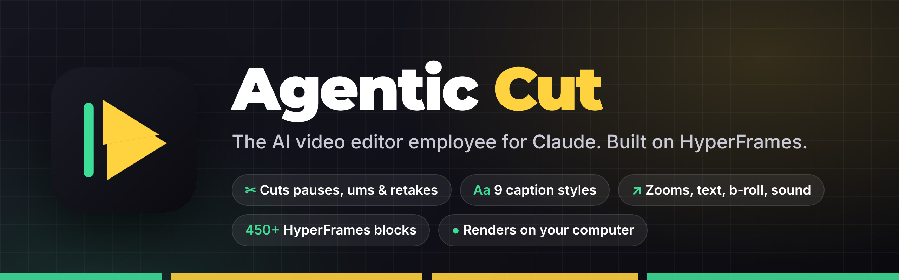
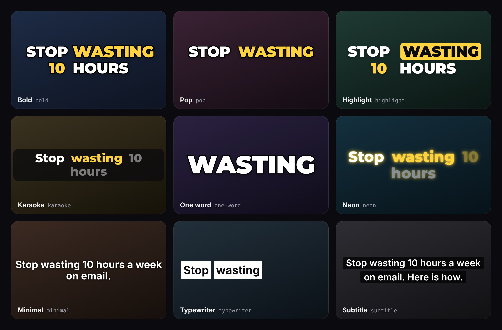
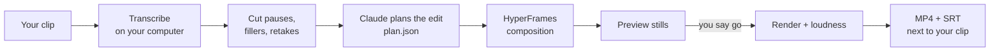

# Agentic Cut

**Your AI video editor employee.** Drop a raw talking-head clip into Claude and say what you want. Agentic Cut cuts
the pauses, "um"s and retakes, adds captions, zooms, text, b-roll, sound and your brand, shows you a preview, and
renders a finished short or YouTube video on your own computer.

Built on [HyperFrames](https://github.com/heygen-com/hyperframes) for the Agentic AI Academy by TakiGPT.

## Install in 3 commands
In Claude Code (terminal, desktop app or IDE):
```
/plugin marketplace add takiw3/ai-video-editor-employee
/plugin install agentic-cut@agentic-cut
/agentic-cut:setup
```
Setup checks for Node.js 22+ and ffmpeg and gives you the one command to install either if it's missing. Then it
downloads the render browser and the on-device speech model. The first run takes 5 to 10 minutes and ends with `READY`.

In the Claude desktop app you can also go to Settings, Customize, Plugins, Discover, add this repository as a
marketplace, and install Agentic Cut from there. Then run `/agentic-cut:setup`.

## Your first video
```
/agentic-cut:brand accent #FFD23F, font Montserrat, bold captions, handle @yourname
/agentic-cut:edit ~/Desktop/take.mov make it a short with a CTA to comment AGENT
```
Claude cuts the take, plans the edit, and shows you a preview sheet and a timeline of the edit. Ask for changes in plain
words ("bigger captions", "zoom in on 'never'", "use my screenshot when I mention the dashboard"), then say **go**.
The finished MP4 and an SRT caption file are saved in the same folder as your recording.

## What it does
- **Cuts the take for you.** Long pauses, filler words and stutters come out, and when you say a line twice, the
  stumbled attempt goes.
  Your voice is cleaned up and levelled.
- **Shorts, long-form and clips.** Vertical shorts for Reels, TikTok and YouTube Shorts; 16:9 YouTube videos; square
  and 4:5 feed posts; and the best moments of a podcast or webinar as vertical clips, with the crop following whoever
  is talking.
- **A full toolbox.** 9 caption styles, 6 cut moves, smooth, snap and push zooms, shake and flash, 9 text styles with
  8 animations (hooks, titles, counters, checklists, quote cards, CTAs), b-roll in 4 layouts with 8 transitions,
  10 sound effects, and music that drops under your voice.
- **HyperFrames built in.** 18 colour looks, 18 film, glitch and print treatments, and the HyperFrames registry:
  450+ lower thirds, overlays, title cards and more, installed only when you use one.
- **Your brand on every frame.** Accent colour, fonts, caption style, look, handle and logo, set once.
- **Approve before it renders.** You get stills of the key moments and give the green light when it looks right.
- **Ready to post.** An MP4 at -14 LUFS (the loudness Reels, TikTok and YouTube expect), plus an SRT caption file.
- **Private and free to run.** Transcription and rendering happen on your computer. No uploads, no per-video fees.

## Caption styles


The word-by-word styles light up each word in your accent colour as it's said. Pick your default with
`/agentic-cut:brand`, or ask for a different one on any video.

## Commands
| command | what it does |
|---|---|
| `/agentic-cut:setup` | install or check everything (once per computer, and after updates) |
| `/agentic-cut:edit <clip>` | turn a raw clip into a short, reel or YouTube video |
| `/agentic-cut:clips <long video>` | find the best moments in a podcast or webinar and cut them into shorts |
| `/agentic-cut:effects [words]` | browse effects, looks, caption styles, sounds and HyperFrames blocks |
| `/agentic-cut:brand` | set your colours, fonts, caption style, look, handle and logo |

You can also just talk to it: "cut this webinar into five clips under 45 seconds", "make this a YouTube video with
a lower third", "add a glitch on every cut".

## How it works

Each video is a folder in `~/agentic-cut/<name>/` with one file that describes it, `plan.json`
([every field](skills/agentic-cut/reference/PLAN.md), [ready-made recipes](skills/agentic-cut/reference/PLAYBOOK.md)).
Claude writes it, so you never have to. The folder is also a normal HyperFrames project, so you can open it in the
HyperFrames Studio and keep going by hand.

The engine is about 1,600 lines of plain Node.js, CSS and browser JavaScript, with no dependencies of its own.
HyperFrames (pinned to 0.9.42) runs through `npx`, so there is nothing to build and nothing heavy in this repo.

## Requirements
- macOS, Windows or Linux
- Node.js 22 or newer, and ffmpeg (setup tells you how to get them)
- About 1 GB of free disk for the render browser and the speech model
- Claude Code or Claude Cowork

Rendering runs every frame through a headless browser, so it takes a few minutes for a short and longer for
long-form. A fast `--draft` render is there for quick checks.

## More
- [Quickstart](docs/QUICKSTART.md): your first edit in 15 minutes
- [Masterclass outline](docs/MASTERCLASS.md): teaching it to a group
- Command line: Claude drives it, but you can too with `node scripts/ac.mjs` (run it with no arguments for the list)

## Licenses
Agentic Cut is MIT licensed ([LICENSE](LICENSE)). It installs and runs third-party software it does not include:
HyperFrames (Apache-2.0), GSAP (GSAP standard license), the speech models HyperFrames downloads, Google Fonts, and the
HyperFrames registry blocks you choose. Details: [THIRD_PARTY_NOTICES.md](THIRD_PARTY_NOTICES.md).
